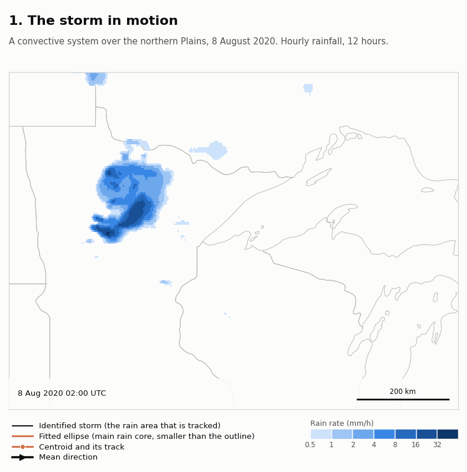
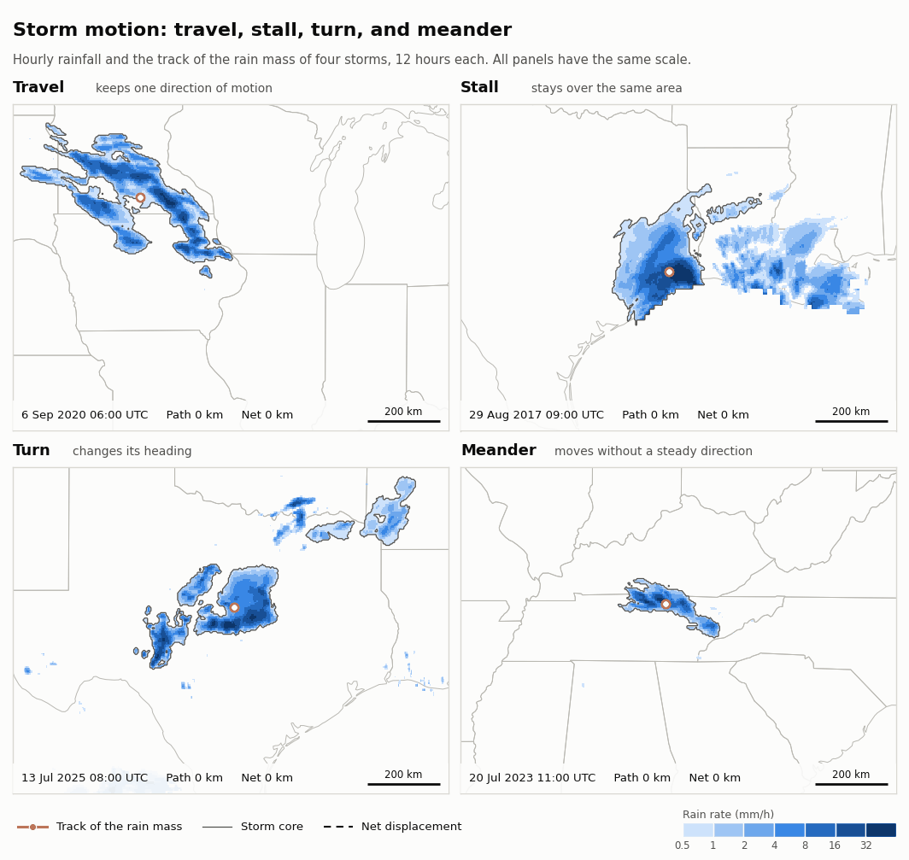
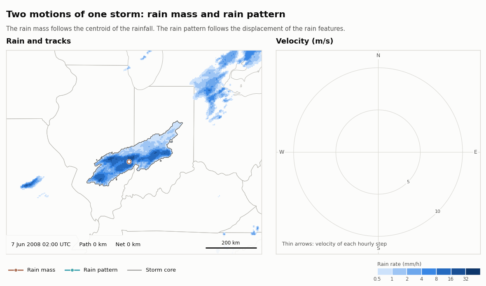
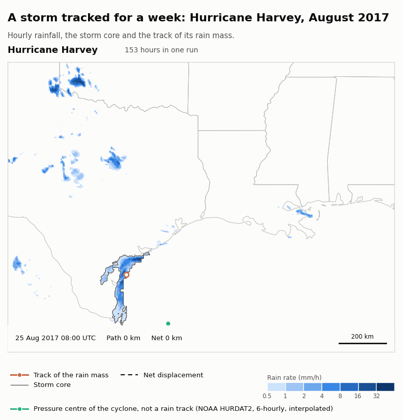

# Storm Motion Analyzer
[](https://www.python.org/downloads/)
[](LICENSE)
[](https://doi.org/10.5281/zenodo.21382060)
 
Storm detection and tracking toolkit for characterizing storm motion (trajectory, direction, speed, and angular variance) from hourly gridded rainfall data.
 
## Tool description
 
Storm-Motion-Analyzer detects storms in NetCDF gridded rainfall data using rainfall thresholding, connected-component labeling, and morphological operations (dilation/erosion), tracks them through time with overlap-based Lagrangian tracking, and characterizes their motion (trajectory, direction, speed, and angular variance), intensity, and spatial extent via moment-based ellipse fitting.
 
The package is designed primarily to process the output storm catalogs produced by the [RainyDay](https://github.com/HydroclimateExtremesGroup/RainyDay) stochastic storm transposition framework, but it works with any hourly gridded NetCDF rainfall dataset. The toolkit has been tested using NOAA's Analysis of Record for Calibration (AORC) rainfall data.

> **New since version 1.1.0, not yet in a release:** the rain-pattern motion, the stall / turn / meander classes, the conditions of the track, new tracking options and the animations shown below. The DOI above is version 1.1.0. See the [changelog](CHANGELOG.md).



*A convective system over the northern Plains on 8 August 2020 (AORC hourly precipitation). The dark outline is the storm that is identified and tracked, and its rain-weighted centroid gives the track. The ellipse is fitted to the main rain core of the storm and describes its size and orientation, so it is smaller than the outline.*

## Storm motion at a glance

### Travel or linger



*Four extreme storms of the contiguous United States, 12 hours each. The stall example is Hurricane Harvey near the Texas–Louisiana border (29 to 30 August 2017).*

The package follows each storm hour by hour through the rain-weighted centroid of its rain area (the **rain mass**) and describes the track with four properties:

| Property | What it is | Column (enlarged table) |
|---|---|---|
| Direction | Mean direction of the hourly steps, weighted by their length. Degrees counter-clockwise from east, toward which the storm moves. | `big_direction_deg` |
| Path speed | Length of the track divided by its duration. | `big_path_speed_ms` |
| Net speed | Distance from the first to the last position divided by the duration. A storm that goes back and forth has a high path speed and a low net speed. | `big_net_speed_ms` |
| Directional coherence | Whether the hourly steps keep a preferred direction (length-weighted Rayleigh test, Monte Carlo null). | `big_coherent`, `big_angular_variance` |

The coherence test separates two kinds of motion, and the storms that do not keep a direction are of three kinds:

| Class | Rule |
|---|---|
| **Travel** (coherent) | The storm keeps a preferred direction of motion. |
| **Linger** (non-coherent) | It does not. It then stalls, turns or meanders: |
| Stall | The centroid ends within one core radius of where it started, or the net speed is below 2 m/s. The storm stays over roughly the same area. |
| Turn | The heading changes by 90° or more between two parts of the track, and every part moves. |
| Meander | The other non-coherent storms: they travel more than one core radius, without a clean turn. |

The class is in the column `linger_class` (`coherent`, `stall`, `turn`, `meander`). The rules and their parameters are in [`motion/linger.py`](stormcatalog_analyzer/motion/linger.py).

### Two motions of one storm



*A mesoscale convective system on 9 June 2008. The rain features move east at 14 m/s. The rain mass moves southwest at 15 m/s, because the heaviest rain shifts along the line toward the southwest.*

A storm has two motions, and they can differ:

- **Rain mass.** The motion of the centroid of the rain. It changes when the rain features move, and also when rain forms on one side of the storm and decays on the other.
- **Rain pattern.** The displacement of the rain features themselves from one hour to the next, measured by a storm-masked cross-correlation of consecutive hours (`pattern_u`, `pattern_v`, `pattern_speed`, `pattern_direction_deg`).
- **Propagation.** The difference between the two (rain mass minus rain pattern): `propagation_u`, `propagation_v`, `propagation_speed`.

In a large convective system the rain features can move one way while the rain mass moves another way, or stays in place, because new rain keeps forming on one flank. Travel or linger is a property of the rain mass. The method is in [`motion/pattern.py`](stormcatalog_analyzer/motion/pattern.py).

### Storms that last several days



*Hurricane Harvey from 25 to 31 August 2017 (AORC hourly precipitation). The green line is the pressure centre of the cyclone from the HURDAT2 best track of the National Hurricane Center (NOAA), given every 6 hours and interpolated to each hour. It is not a rain track; it is an independent reference.*

The examples above are 12-hour windows of 24-hour events, but the tracking has no limit of duration. Here the same functions follow one storm for 153 consecutive hours on a fixed area. The rain mass stays near the Texas coast for about four days and then moves northeast. It is about 200 km from the centre of the hurricane, because the heavy rain is on that side of it.

```python
from dataclasses import replace
import numpy as np
from stormcatalog_analyzer import enlarged as E

fld = E.read_aorc_field(aorc_folder, hours, west, south, east, north)        # hourly rain of the whole period
rain = np.nan_to_num(fld.rain)
cfg = E.EnlargedConfig(tracker="robust:partition_keepsplit", core_threshold_mmhr=2.0)
labels = E.track_field(rain, cfg, fld.lat, fld.lon)                          # every rain area, hour by hour
table = E.track_table(labels, rain, E.pixel_area_km2(fld.lat, fld.lon), weight=box, lat=fld.lat, lon=fld.lon)
k, run = E.select_circle_storm(table)                                        # the storm with most rain in the box
motion = E.v6_descriptors(rain, labels, k, run, fld.lat, fld.lon, fld.times, "harvey", replace(cfg, window_hr=len(run)))
```

Tracking the 168 hours takes about 15 seconds on a workstation. For long events, identify the storms from cores (`core_threshold_mmhr`): a system that lasts days joins and releases distant rain bands, and with the whole rain area these bands pull the centroid back and forth. The complete example is [`docs/animations/extract_long_event.py`](docs/animations/extract_long_event.py).

### How robust is the class of one storm?

The class of a single storm depends on how the storm is tracked: the size of the tracking window, the hours that are analysed, and how the rain area is identified. Shares over many storms are stable across these choices; the label of one storm is less so. Two tools help to check this:

- `EnlargedConfig(conditions=True)` adds flags for the situations in which the centroid moves for reasons other than the motion of the rain (`track_condition`: `window`, `two_pieces`, `absorbed`, `scattered`, or `none`). See [`conditions.py`](stormcatalog_analyzer/conditions.py).
- The same catalog can be tracked under several settings in one pass (`analyze_catalog_file_variants`), to see which storms keep their class.
 
## Quick start
 
**Prerequisites:** Python 3.9+ and the scientific + geospatial Python stack (NumPy, SciPy, pandas, xarray, netCDF4, scikit-image, geopandas, shapely, cartopy, pyproj, matplotlib, seaborn, windrose).

> **Install the dependencies before using the repo.** The recommended way is a conda environment from [`environment.yml`](environment.yml), which pulls the geospatial stack (cartopy, geopandas, pyproj) cleanly from conda-forge. A `pip install -r requirements.txt` also works if you already have the system GDAL/GEOS/PROJ libraries.
>
> **Troubleshooting:** if saving a figure raises `GEOSException: ... Points of LinearRing do not form a closed linestring`, your `shapely` is ≥ 2.1 (it tightened ring validation and breaks cartopy's gridline labels) — pin it with `pip install "shapely<2.1"`.
 
```bash
git clone https://github.com/Perez-HydroSystems/storm-motion-analyzer.git
cd storm-motion-analyzer
 
conda env create -f environment.yml      # create the env with all dependencies
conda activate storm-motion-analyzer

pip install -e .                         # optional: enables the `stormcatalog-analyzer` CLI
```
 
You need two things to run an analysis: a storm event or a storm catalog (a folder of NetCDF events) and a JSON config. All inputs, paths, and model parameters live in one config file — see [`configs/testing_data.json`](configs/testing_data.json).
 
```bash
# Catalog-level diagnostic plots (main deliverable)
python run_diagnostics.py --config configs/testing_data.json
 
# Per-event tracking figures for a single storm (by filename, substring, or id)
python run_diagnostics.py event --config configs/testing_data.json --storm 100
```
 
If installed with `pip install -e .`, the same commands are available as `stormcatalog-analyzer diagnostics|event|drift|enlarged|systems ...`.
 
Prefer a notebook? Open [`notebooks/storm_motion_catalog.ipynb`](notebooks/storm_motion_catalog.ipynb) — it loads the config and runs the same pipeline.
 
## Usage
 
### Python API
 
```python
from stormcatalog_analyzer.config import load_config
from stormcatalog_analyzer import pipeline
 
cfg = load_config("configs/testing_data.json")
cfg.tracking.rainfall_threshold_mmhr = 2   # optional inline overrides
 
out = pipeline.run(cfg)                # track -> summarize -> diagnostics
out["summary"].storm_properties.head()
print(out["figures"])                  # saved figure paths
print(out["table"])                    # per-storm properties CSV
```
 
### Outputs
 
Written to `<output_dir>/<domain_name>/`:
 
- `storm_properties_<domain>.csv` — one row per storm: mean speed & direction, mean/peak intensity, total accumulated rainfall, ellipse major/minor axis + angle, area, duration, trajectory length.
- Diagnostic figures: trajectory map + wind rose, direction vectors, statistics pairplot.
### Notebooks
 
| Notebook | Purpose |
|---|---|
| [`notebooks/storm_motion_catalog.ipynb`](notebooks/storm_motion_catalog.ipynb) | Process all the events in the storm catalog, generating the summary and individual diagnostic plots. |
| [`notebooks/storm_motion_event.ipynb`](notebooks/storm_motion_event.ipynb) | Per-event spatiotemporal plots and tracking results. |
 
### Directional coherence

Every storm is tested for directional coherence. The test is a length-weighted Rayleigh test of the hourly movement directions of the analysed window, with a Monte Carlo null and a reproducible seed per storm. The properties table reports `angular_variance`, `p_weighted` and `coherent` (p < 0.05). A coherent storm kept a preferred direction of motion; a non-coherent storm did not (it stalled, turned or meandered). The test describes the directions of motion, not the accuracy of the tracking.

### Enlarged-window tracking

RainyDay screens events tile by tile, and a storm tracked only inside its tile is clipped at the tile edge. The `enlarged` module tracks each catalog event on the tile enlarged by a margin (default 5°), reading the hourly rain field directly (AORC), and selects the storm of the event by the screening circle.

```bash
# one tile: events table (parquet) and storm footprints next to it
stormcatalog-analyzer enlarged --catalog-dir <tile>/StormCatalog --aorc-dir <AORC folder> --tile B7 --out out/B7.parquet

# storm systems shared by several tiles
stormcatalog-analyzer systems --footprints out/*_footprints.parquet --out out/systems.csv
```

Each event records the motion descriptors and the coherence test, the share of the storm's rain outside the tile, the valid-data fraction, edge contacts, and the jumps of the centroid (an hourly step more than 3 times the median step and more than 30 km).

Options of the enlarged-window tracking (`EnlargedConfig`, and the same names in the command line):

| Option | Meaning |
|---|---|
| `margin_deg` | Degrees added to each side of the tile (default 5). |
| `analysis_hours` | Which 12 consecutive hours of a longer track are analysed. `"intensity"` (default): the largest mean rain rate inside the fitted ellipse. `"rate"`: the largest mean rain rate of the identified storm (no ellipse). `"tile"`: the most rain of the storm over the tile. Command line: `--analysis-hours`. |
| `core_threshold_mmhr` | Identify the storms by their cores above this rate, so that storms joined by light rain stay separate (`--core-threshold 2`; needs a `robust:` tracker). |
| `linger_class` | Add the stall / turn / meander class. |
| `pattern` | Add the rain-pattern and propagation velocities. |
| `conditions` | Add the tracking-condition flags (`--conditions`). |

### Robust linking

A jump occurs when a track changes composition at a merge or a split. `tracking.robust` adds linking options that reduce these jumps; all are off by default, and the default settings reproduce the standard linking. `PRESETS` names the combinations. The storm-motion paper uses `partition_keepsplit`: when two storms merge, the merged object is divided among its parents, so each track follows its own rain.

```python
from stormcatalog_analyzer import enlarged as E

# "robust:<preset>" selects a preset by name; it also works in the worker processes
cfg = E.EnlargedConfig(margin_deg=15.0, tracker="robust:partition_keepsplit", analysis_hours="tile",
                       linger_class=True, pattern=True, conditions=True)
events, footprints = E.run_catalog("<tile>/StormCatalog", "<AORC folder>", cfg, tile="B7", workers=4)
events[["storm_event", "big_direction_deg", "big_net_speed_ms", "big_coherent", "linger_class",
        "pattern_direction_deg", "pattern_speed", "track_condition"]]
```

## What it extracts
 
- **Motion** — trajectory, translation speed, direction, spatial probability of direction motion.
- **Intensity** — peak and mean rainfall intensity for each storms.
- **Spatial morphology** — storm area coverage, ellipse area and dimensions.

- **Envelope drift** — the slow, sustained displacement of the whole rain field over an event (where the rain falls on day 1 versus day 5), from a rain-weighted trend of 6-h centroids, for the whole event and for its wettest 72 h, with optional components along a reference axis (for example, a river basin's downstream axis). This is the motion that matters for flood response, because a rain envelope that drifts with the flood wave concentrates runoff in time. It is distinct from the storm-cell motion above.

```bash
python run_diagnostics.py drift --config configs/testing_data.json --axis 156   # writes storm_drift_<domain>.csv + figure
```

**Direction convention.** Detection, tracking, and ellipse fitting run on the equal-area EPSG:2163 grid, but all motion metrics (direction, speed, trajectory length, angular variance) are geodesic on the WGS84 ellipsoid, computed from the centroid longitude/latitude. Directions give the direction of motion in degrees counterclockwise from east (0° = east, 90° = north, 180° = west, 270° = south), relative to true east/north. The reported mean direction is the distance-weighted circular mean of the geodesic segment directions. It is not exactly the first-to-last direction, so that direction is reported separately (`endpoint_direction_deg`).


 

## Authors
 
- Diego F. Osorio-Giraldo — School of Civil and Environmental Engineering, Oklahoma State University
- Gabriel Perez — School of Civil and Environmental Engineering, Oklahoma State University

## Acknowledgements
- Yuan Liu — provided seminal functions for the storm tracking algorithm.

## How to cite

If you use this software, please cite it — GitHub's "Cite this repository" button (generated from [`CITATION.cff`](CITATION.cff)) gives ready-made BibTeX/APA entries:

> Osorio-Giraldo, D. F., & Perez, G. (2026). *Storm Motion Analyzer* (Version 1.1.0) [Computer software]. Zenodo. https://doi.org/10.5281/zenodo.24487598

To cite all versions of the software, use the concept DOI [10.5281/zenodo.21382060](https://doi.org/10.5281/zenodo.21382060), which always resolves to the latest release.

## License
 
MIT — see [LICENSE](LICENSE).